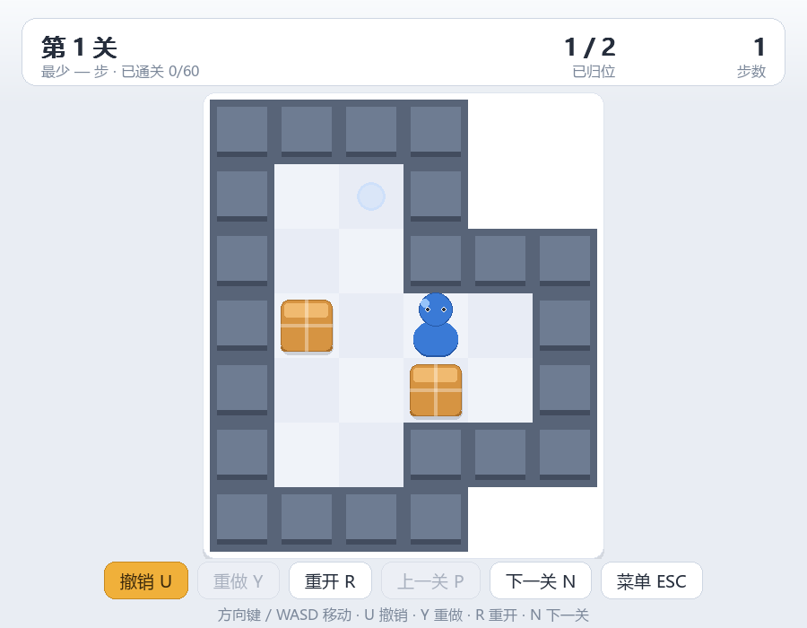

# 推箱子 Sokoban

经典 60 关推箱子，pygame 单文件实现，**零外部素材**（图形全部程序化绘制，音效由 numpy 合成）。



## 玩法

把每个箱子推到目标点上。箱子只能**推**不能拉，推到墙角就再也出不来了 —— 所以每推一步都要想清楚。

### 操作

| 按键 | 作用 |
| --- | --- |
| `方向键` / `WASD` | 移动（按住可连续走） |
| `U` | 撤销 |
| `Y` | 重做 |
| `R` | 重开本关 |
| `N` | 下一关 |
| `P` | 上一关 |
| `ESC` | 回菜单 |
| `M` | 静音开关 |

菜单和结算界面也可以用鼠标点击按钮。

## 运行

### Windows

双击 `run.bat`。

没装 pygame 的话，双击 `install_deps.bat` 会自动从国内镜像安装（腾讯云，失败则换华为云）。

### Linux / macOS

```bash
chmod +x run.sh
./run.sh
```

或手动：

```bash
python3 -m pip install pygame
python3 sokoban.py
```

> **非 Windows 用户请注意字体**：界面是中文的，需要系统装有中文字体。
> Debian/Ubuntu 上执行 `sudo apt install fonts-noto-cjk`；
> macOS 自带苹方（PingFang SC），无需额外安装。
> 程序会按「字体文件路径 → 族名匹配 → SysFont」三级查找，并**逐个验证字形真的存在**
> （缺字形时汉字会渲染成方框，程序会检测到并跳过该字体）。全部失败时会打印明确警告。

## 关卡

内置 **60 关**，取自 David W. Skinner 的经典公开关卡集 **Microban**
（作者 2000 年发布，专为入门与儿童设计，规模小、每一关各演示一个推箱子概念）。

- 尺寸从 6×7 到 15×12，单关最多 6 个箱子，难度由浅入深。
- **每一关都用内置求解器验证过确实可解**（见 `selftest.py`），不存在"死局关卡"。
- 通关进度与每关最少步数记在内存中（关掉程序即清空）。

> 关卡版权归原作者 David W. Skinner 所有，此处按其公开传播的原始文本收录，
> 仅作学习与演示用途。

## 玩法与实现的几个细节

- **连续移动**：按住方向键，首次延迟约 22 帧后开始以每 7 帧一格的速度连走，
  换方向立即响应。松开即停。
- **撤销 / 重做**：完整记录每一步（方向、箱子原位置、玩家原位置、箱子新位置），
  撤销与重做严格互逆——自检里做了"逐关逐方向走一步再撤销、断言局面完全还原"的对拍。
  走新的一步会清空重做栈（不能穿越到旧分支）。
- **吞键保护**：滑动动画未结束时按下的方向键会被忽略，避免动画期间连点导致跳格。
  自动求解/自检路径用 `try_move(d, ignore_anim=True)` 跳过这层节流。
- **文字不溢出**：所有 HUD 都是一列一列按实测文本宽度摆放的，右对齐内容统一用
  `topright` 锚点；棋盘按窗口实际尺寸反算居中和格宽，不用常量硬推。
- **符号不用字体画**：`✓ ▶ ◀` 这几个字符在微软雅黑里没有字形（实测渲染出来是同一个
  `.notdef` 方块），所以对勾和翻页箭头一律用 `pygame.draw` 画。
- **音效降级**：numpy 或音频设备缺失时整体静默，绝不报错崩溃。

## 自检

```bash
python selftest.py            # 完整检查，含 60 关全解验证（约 1 分钟）
python selftest.py --quick    # 跳过全解验证（约 3 秒）
python selftest.py --shots    # 额外导出预览截图
```

自检覆盖 80+ 项断言，包括：

- 关卡数据完整性（箱数 == 目标数、地图封闭、目标可达）
- **60 关逐个用求解器验证可解**
- 推箱规则、撞墙、箱子后是墙时推不动
- 撤销/重做严格互逆（逐关逐方向对拍 + 随机长序列 + 逐步对齐）
- 求解器真跑一局 → 通关 → 记录步数 → 切换关卡的整条链路
- 已通关不重复结算
- 状态机（标题/游戏/选关/结算）与真实 `KEYDOWN` 事件驱动
- 鼠标点击按钮、格子↔屏幕坐标往返换算
- 渲染像素检查（玩家色、箱子色、HUD 文字确实画出来）
- 中文字体字形覆盖（含"默认位图字体应被判为不含汉字"的反向验证）
- 音频降级、2500 帧压力测试

## 文件说明

| 文件 | 说明 |
| --- | --- |
| `sokoban.py` | 游戏本体（单文件，含关卡数据与求解器） |
| `selftest.py` | 无窗口自检 |
| `make_preview.py` | 生成 `preview/` 里的截图 |
| `run.bat` / `run.sh` | 启动脚本 |
| `install_deps.bat` | Windows 一键安装依赖 |
| `preview/` | 预览截图 |

## 许可

MIT License，见 `LICENSE`。
关卡数据归原作者 David W. Skinner 所有。
